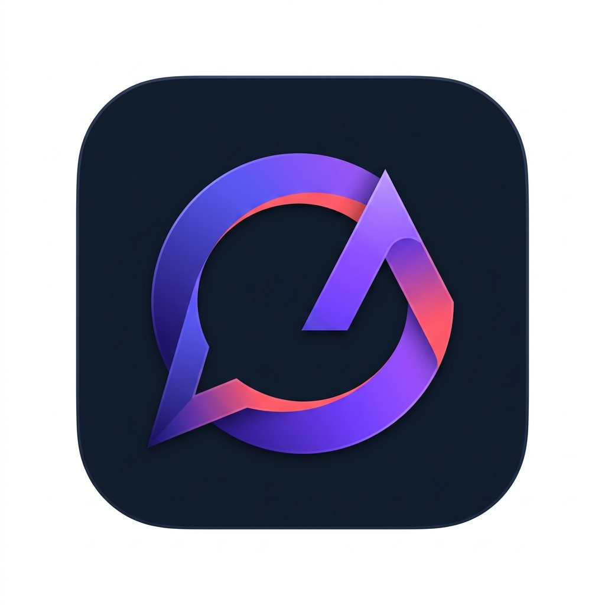

<p align="center">
  
  <h1 align="center">Dumroo Feedback</h1>
  <p align="center">
    <strong>Production-Grade In-App Feedback, Support & Issue Reporting Platform</strong><br/>
    <em>Atomic Reference Sequencing, Viewport Capture, Supabase Private Storage, Transactional Outbox Engine, and Microsoft Teams Adaptive Cards.</em>
  </p>
  <p align="center">
    <a href="#-quick-start"></a>
    <a href="LICENSE"></a>
    
    
    
    
    
    
    
  </p>
  <p align="center">
    <a href="#-what-is-dumroo-feedback">About</a> · 
    <a href="#-the-problem">The Problem</a> · 
    <a href="#-features">Features</a> · 
    <a href="#-architecture">Architecture</a> · 
    <a href="#-pipeline-workflow">Pipeline</a> · 
    <a href="#-feature-comparison">Comparison</a> · 
    <a href="#-quick-start">Quick Start</a> · 
    <a href="#-configuration-reference">Configuration</a> · 
    <a href="#-api-documentation">API Docs</a> · 
    <a href="#-project-structure">Structure</a>
  </p>
</p>

---

## What is Dumroo Feedback?

**Dumroo Feedback** is an enterprise-grade, in-app customer support and issue-reporting system designed for high-availability SaaS platforms. Mounted as a persistent floating widget across all authenticated user interfaces, it replaces fragmented customer email threads with a structured, automated reporting channel.

When clients encounter bugs or UI friction, asking them to draft emails results in missing browser context, uncompressed image attachments, and delayed customer triage. Dumroo Feedback eliminates this friction by capturing rich diagnostic telemetry (URL, viewport dimensions, OS, browser engine, timestamps), rendering client-side viewport screenshots on demand, and streaming rich Adaptive Cards directly to engineering channels on **Microsoft Teams** in real time.

Built on an **Evidence Over Inference** architecture, Dumroo Feedback is engineered with zero-compromise reliability:

- **100% Non-Blocking Submissions (Transactional Outbox)** — Reports and notification jobs are committed atomically into MongoDB via sessions. Submissions succeed in sub-millisecond time, while an asynchronous polling worker handles notification delivery in the background.
- **Teams Downtime Immunity** — If Microsoft Teams or Power Automate triggers experience network latency or outages, reports are never dropped. An exponential-backoff worker retries failed dispatches automatically.
- **Deterministic Atomic Sequence Numbering** — Generates human-readable reference IDs (`FB-2026-00042`) using atomic MongoDB `$inc` counters, ensuring collision-free ticket tracking.
- **Private Cloud Storage with Expiring Signed URLs** — Screenshots and logs are saved to private Supabase Storage buckets. Only authenticated users and support staff with short-lived signed tokens can view attachments.
- **Client-Side Optimization** — Zero-overhead canvas capture via `html2canvas` paired with client-side lossy compression (`browser-image-compression`), reducing image payload sizes by up to 80% before transmission.
- **Bespoke SaaS Design System** — Built with custom CSS custom properties, micro-interactions, category color palettes, focus traps, and dark mode support.

---

## The Problem

Managing customer issue reports via uncoordinated emails or naive third-party chat widgets introduces critical operational vulnerabilities:

| Operational Challenge | Traditional Support Emails / Naive Widgets | With Dumroo Feedback |
|---|---|---|
| **Diagnostic Context** | "The button doesn't work" with zero environmental details | **Automatic Telemetry**: User agent, OS, exact URL, screen resolution, viewport dimensions |
| **Screenshot Handling** | Giant 15MB PNGs pasted into email bodies or dropped onto public image hosts | **Client-Side Compression**: Compact WebP/JPEG uploaded to private buckets via signed URLs |
| **Notification Reliability** | Webhook fails $\rightarrow$ Customer receives a 500 error and report is lost forever | **Transactional Outbox**: Atomic MongoDB commits with resilient background backoff workers |
| **Ticket Reference Tracking** | Messy email subjects or ambiguous UUID hashes | **Atomic Sequence**: Clean, predictable IDs like `FB-2026-00108` generated via counter collections |
| **Security & Privacy** | Public S3 buckets leaking customer UI data | **Private Access**: Bounded storage keys scoped strictly to `feedback/{orgId}/{userId}/{uuid}.{ext}` |
| **Support Team Velocity** | Engineers log into separate dashboards to review tickets | **Actionable MS Teams Cards**: Formatted Adaptive Cards with one-click screenshot links and metadata |

---

## Features

### 1. In-App Floating Widget & Spring-Animated Modal
- Mounts **exactly once** inside the authenticated root layout (`AuthenticatedLayout.jsx`), persisting across all internal routes without re-rendering.
- Polished micro-interactions: Floating launcher button with soft hover elevation, pulse indicator, keyboard focus rings, and accessible tooltips.
- Modal dialog equipped with accessible keyboard controls (`Escape` key dismissal, focus trapping, and `aria-modal` compliance).
- Dynamic category picker with bespoke icon badges and harmonic accent palettes:
  - 🐞 **Bug Report** — Warm Coral / Rose (`#ef4444`)
  - 🎨 **UI / UX Issue** — Electric Violet / Indigo (`#8b5cf6`)
  - 💡 **Feature Request** — Teal / Emerald (`#10b981`)
  - 💬 **General Feedback** — Amber (`#f59e0b`)
  - 📌 **Other** — Slate (`#64748b`)

### 2. Client-Side Screenshot Capture & Multi-Attachment Engine
- **One-Click Viewport Capture**: Uses `html2canvas` to render the user's current viewport with UI widgets automatically hidden from the snapshot.
- **Client-Side Compression**: Automatically compresses high-resolution screen captures down to `< 1MB` via `browser-image-compression` before transmission.
- **Multi-File Drag-and-Drop**: Supports additional image attachments (PNG, JPEG, WebP) up to 5MB each, capped at 5 attachments per report.
- Interactive attachment previews with instant image magnification modals and removal triggers.

### 3. Pre-Signed Private Storage Abstraction
- Implements the **StorageService** abstraction layer (`StorageInterface`), decoupling business logic from cloud storage providers (Supabase, AWS S3, Cloudflare R2).
- Enforces strict server-side pre-validation: MIME types (`image/png`, `image/jpeg`, `image/webp`), file extensions, and size limits.
- Generates short-lived signed upload URLs bound directly to authenticated user scopes:
  $$\text{Key Path} = \texttt{feedback/}\{\text{organizationId}\}\texttt{/}\{\text{userId}\}\texttt{/}\{\text{uuid}\}\texttt{.}\{\text{ext}\}$$
- Enforces storage key ownership verification during submission to prevent cross-tenant tampering.

### 4. Transactional Outbox Pattern & Resilient Retry Worker
- Submissions leverage MongoDB replica-set transactions:
  $$\text{Session} \longrightarrow \big[ \text{Create Feedback Document} \;\land\; \text{Create Notification Outbox Entry} \big]$$
- **Atomic Job Claiming**: Worker polls the outbox and claims ready records atomically using `findOneAndUpdate({ status: 'pending', nextRetryAt: { $lte: now } }, { $set: { status: 'processing' } })`, preventing double-dispatch in clustered deployments.
- **Exponential Backoff**: Retries transient Teams webhook failures across 5 scheduled intervals:
  $$\text{Delays: } [0\text{s (immediate)}, \; 30\text{s}, \; 2\text{m}, \; 10\text{m}, \; 30\text{m}]$$
- Automated cron tasks recover stale jobs stuck in `processing` and prune orphaned storage uploads after grace periods.

### 5. Microsoft Teams Adaptive Cards v1.4
- Dispatches structured Adaptive Cards to Teams channels via Power Automate / Workflows HTTP triggers.
- Formatted with structured `FactSet` blocks: Reference ID, Category, Submitter Email, Organization, UTC Timestamp, Reported URL, OS, and Browser.
- All user-supplied text is sanitized against HTML and control characters before rendering.
- Embeds temporary 7-day signed download URLs for screenshots, ensuring engineers can inspect visuals without exposing public bucket assets.

### 6. Idempotency & Rate Limiting Defense
- Full `Idempotency-Key` header support backed by a unique sparse index `(userId + idempotencyKey)`. Retrying a network request returns the original submission record without re-incrementing counters or re-notifying Teams.
- Tiered `express-rate-limit` guards:
  - Pre-signed URL endpoint: **30 requests / 15 minutes**
  - Submission endpoint: **20 reports / 15 minutes**

### 7. User Reports Portal & Admin Governance
- Authenticated "My Reports" view with pagination, search, category filters, and status pill badges (`Open`, `Under Review`, `In Progress`, `Resolved`, `Closed`).
- Role-based Admin routes (`PATCH /api/feedback/:id/status` and `POST /api/feedback/notifications/:id/retry`) guarded by `adminGuard` middleware.

---

## Architecture

```
┌─────────────────────────────────────────────────────────────────────────────┐
│                       React 18 + Vite Web Workspace                         │
│   AuthenticatedLayout · Floating FeedbackWidget · Modal Dialog · Canvas     │
└──────────────────────────────────────┬──────────────────────────────────────┘
                                       │ HTTPS / JSON / Idempotency-Key
┌──────────────────────────────────────▼──────────────────────────────────────┐
│                         Express.js 4 REST API Gateway                       │
│    Helmet · CORS · Rate Limiter · JWT Auth Guard · Validator · ErrorHandler │
└──────────────┬───────────────────────┬───────────────────────┬──────────────┘
               │                       │                       │
     Signed    │         Mongoose      │ MongoDB               │ Private
     Uploads   │         Transactions  │ Sessions              │ Storage
┌──────────────▼─────────────┐ ┌───────▼────────────────┐ ┌────▼──────────────┐
│   Supabase Storage Engine  │ │  MongoDB Atlas M0+     │ │ Microsoft Teams   │
│   - Private Bucket         │ │  - feedback_submissions│ │   Workflows       │
│   - Expiring Signed URLs   │ │  - notification_outbox │ │ - Power Automate  │
│   - Path Tenant Isolation  │ │  - counters (FB-YYYY)  │ │ - Adaptive Cards  │
└────────────────────────────┘ └───────▲────────────────┘ └────▲──────────────┘
                                       │                       │
                                       │ Atomic Claim & Poll   │ HTTP POST
                               ┌───────┴───────────────────────┴──────┐
                               │   Background Outbox Polling Worker   │
                               │   - node-cron Polling Loop (5s)      │
                               │   - Exponential Backoff Retrier      │
                               │   - Stale Processing Job Recovery    │
                               │   - Orphaned Storage Cleanup         │
                               └──────────────────────────────────────┘
```

---

## Pipeline Workflow

```
┌──────────┐    ┌─────────────┐    ┌──────────────┐    ┌─────────────┐    ┌─────────────┐
│  Client  │    │  html2canvas│    │  Request Pre-│    │ Direct Push │    │   Submit    │
│  Trigger ├───►│  Viewport   ├───►│  Signed URL  ├───►│ to Supabase ├───►│   Feedback  │
│  Widget  │    │  Capture    │    │  Storage Key │    │ Private S3  │    │   Payload   │
└──────────┘    └─────────────┘    └──────────────┘    └─────────────┘    └──────┬──────┘
                                                                                 │
┌──────────┐    ┌─────────────┐    ┌──────────────┐    ┌─────────────┐           │
│ MS Teams │    │ Adaptive    │    │ Outbox Worker│    │ Atomic Mongo│           │
│ Channel  │◄───┤ Card Format ◄────┤ Polls Queue  │◄───┤ Transaction │◄──────────┘
│ Notified │    │ Generation  │    │ (Backoff)    │    │ (FB + Outbox│
└──────────┘    └─────────────┘    └──────────────┘    └─────────────┘
```

---

## Feature Comparison

| Capability | Dumroo Feedback | Traditional Email | Generic SaaS Chat (Intercom) | Jira Service Management | Standard Webhook |
|---|:---:|:---:|:---:|:---:|:---:|
| **Non-Blocking Submissions** | ✅ **Transactional Outbox** | ❌ N/A | ⚠️ Network Bound | ⚠️ Synchronous API | ❌ Fails on Webhook Outage |
| **Automatic Viewport Capture** | ✅ **Built-in `html2canvas`** | ❌ Manual Attachment | ⚠️ Paid Add-on | ❌ Manual Upload | ❌ |
| **Deterministic Ticket IDs** | ✅ **`FB-YYYY-NNNNN`** | ❌ Subject Line | ⚠️ Opaque UUID | ✅ Issue Key | ❌ |
| **Private Screenshot Security** | ✅ **Signed Expiring URLs**| ⚠️ Public / Attachment | ⚠️ Proprietary CDN | ⚠️ Role Gated | ❌ Often Public S3 |
| **Native Teams Adaptive Cards** | ✅ **Adaptive Cards v1.4** | ❌ | ⚠️ Webhook Card Only | ⚠️ Jira Plugin Needed | ⚠️ Plain JSON / Text |
| **Tenant Storage Isolation** | ✅ **Path-Bound Scopes** | ❌ | ⚠️ Shared Bucket | ⚠️ Tenant ID | ❌ |
| **Resilient Retry Backoff** | ✅ **5-Stage Backoff** | ❌ | ❌ | ⚠️ Worker Queue | ❌ Single Attempt |
| **Offline Test Coverage** | ✅ **In-Memory Replica Set**| ❌ | ❌ | ❌ | ❌ |

---

## Quick Start

### Prerequisites
- **Node.js**: `18.x LTS` or `20.x+`
- **npm**: `9.x` or `10.x`
- **MongoDB**: MongoDB Atlas M0+ (or local replica set with transaction support)
- **Supabase**: Free-tier project with a private storage bucket named `feedback-attachments`
- **Microsoft Teams**: Power Automate / Workflows HTTP-trigger webhook URL

---

### Step 1: Clone and Install Dependencies

```bash
git clone https://github.com/keshavagr273/DumrooAI-Assignment.git
cd DumrooAI-Assignment

# Install backend dependencies
cd backend
npm install

# Install frontend dependencies
cd ../frontend
npm install
```

---

### Step 2: Configure Environment Variables

Create environment configuration files from the provided templates:

```bash
# In the backend directory
cp .env.example .env

# In the frontend directory
cp .env.example .env
```

#### Backend Configuration (`backend/.env`):
```env
PORT=5000
NODE_ENV=development
FRONTEND_URL=http://localhost:5173

# MongoDB Atlas (Replica Set required for transactions)
MONGODB_URI=mongodb+srv://<username>:<password>@cluster0.mjg4j09.mongodb.net/feedback_system?retryWrites=true&w=majority

# JWT Authentication
JWT_SECRET=super_secret_jwt_passphrase_at_least_32_characters_long_prod
JWT_EXPIRES_IN=7d

# Supabase Private Storage
SUPABASE_URL=https://your-project-id.supabase.co
SUPABASE_SERVICE_ROLE_KEY=your_supabase_service_role_key_here
SUPABASE_STORAGE_BUCKET=feedback-attachments

# Microsoft Teams Power Automate Webhook
TEAMS_FEEDBACK_WEBHOOK_URL=https://prod-XX.westus.logic.azure.com:443/workflows/...
```

> [!NOTE]
> **MongoDB Atlas IP Access**: Ensure your current machine IP address is whitelisted in MongoDB Atlas under **Security $\rightarrow$ Network Access**.

#### Frontend Configuration (`frontend/.env`):
```env
VITE_API_BASE_URL=http://localhost:5000/api
```

---

### Step 3: Run Development Servers

Start the backend API server and frontend development server in separate terminals:

```bash
# Terminal 1: Backend Server (Port 5000)
cd backend
npm run dev

# Terminal 2: Frontend Web Client (Port 5173)
cd frontend
npm run dev
```

### Access Your Applications:
- 🌐 **Frontend Workspace**: [http://localhost:5173](http://localhost:5173)
- ⚙️ **Backend Health Check**: [http://localhost:5000/api/health](http://localhost:5000/api/health)

---

### Step 4: Seed Demo Accounts

With the backend running, populate the database with seed test accounts:

```bash
curl -X POST http://localhost:5000/api/auth/seed
```

| Account Role | Email Address | Password | Permissions |
|---|---|---|---|
| **Standard User** | `user@acme.com` | `Password123!` | Submit feedback, view personal reports |
| **Workspace Admin** | `admin@acme.com` | `Admin123!` | Status triage, re-queue failed outbox jobs |

---

## Configuration Reference

All backend configurations are validated at boot time via Zod and central configuration modules:

| Variable | Default Value | Description |
|---|---|---|
| `PORT` | `5000` | Port on which the Express REST API listens |
| `NODE_ENV` | `development` | Runtime environment (`development`, `production`, `test`) |
| `FRONTEND_URL` | `http://localhost:5173` | Allowed CORS origin for browser requests |
| `MONGODB_URI` | *(required)* | MongoDB connection string (supports `+srv` syntax) |
| `JWT_SECRET` | *(required)* | Cryptographic salt used for signing access tokens |
| `JWT_EXPIRES_IN` | `7d` | Token expiration lifespan |
| `SUPABASE_URL` | *(optional for test)* | Supabase project API gateway endpoint |
| `SUPABASE_SERVICE_ROLE_KEY` | *(optional for test)* | Secret service role key (bypasses RLS) |
| `SUPABASE_STORAGE_BUCKET` | `feedback-attachments` | Name of private storage bucket |
| `TEAMS_FEEDBACK_WEBHOOK_URL`| *(optional for test)* | Power Automate HTTP trigger webhook URL |
| `VITE_API_BASE_URL` | `http://localhost:5000/api` | Base URL used by the Axios client in React |

---

## API Documentation

All application endpoints (except authentication and health checks) require an `Authorization: Bearer <token>` header:

### Endpoint Catalog:

| Method | Endpoint | Auth | Rate Limit | Description |
|---|---|:---:|:---:|---|
| `GET` | `/api/health` | Public | None | Service heartbeat and uptime status |
| `POST` | `/api/auth/register` | Public | None | Create new user account |
| `POST` | `/api/auth/login` | Public | None | Authenticate user and issue JWT |
| `POST` | `/api/auth/seed` | Public | Dev Only | Seed test accounts for development |
| `POST` | `/api/feedback/upload-url` | User | 30 / 15m | Validate MIME/size and generate signed upload URL |
| `POST` | `/api/feedback` | User | 20 / 15m | Submit feedback report + outbox task atomically |
| `GET` | `/api/feedback/my-reports` | User | None | Fetch paginated reports with status filters |
| `GET` | `/api/feedback/:id` | User | None | Retrieve specific report with signed attachment URLs |
| `PATCH` | `/api/feedback/:id/status` | Admin | None | Update report lifecycle state |
| `POST` | `/api/feedback/notifications/:id/retry` | Admin | None | Re-queue failed Teams notification job |

---

## Test Suite Execution

Both frontend and backend include automated test suites. The backend features an offline-safe test database harness that automatically falls back to an in-memory replica set (`mongodb-memory-server`) if Atlas is unreachable:

```bash
# Run all backend unit and integration tests (25 passing tests)
cd backend
npm test

# Run all frontend component tests (11 passing tests)
cd ../frontend
npm test
```

### Verification Ledger:
- ✅ **Backend Suite**: 5 test suites, 25 tests passed (`referenceId`, `storageService`, `teamsCard`, `retryDelays`, `feedback.api`)
- ✅ **Frontend Suite**: 4 test suites, 11 tests passed (`CategorySelector`, `ContextDisclosure`, `DescriptionField`, `FeedbackSuccess`)
- ✅ **Production Build**: Verified with Vite production tree-shaking (`vite build` exit code 0)

---

## Project Structure

```text
dumrooAI-assignment/
├── backend/
│   ├── src/
│   │   ├── app.js                         # Express application definition, security middlewares
│   │   ├── server.js                      # HTTP server listener, worker lifecycle, graceful shutdown
│   │   ├── config/
│   │   │   ├── env.js                     # Zod-backed environment validation & defaults
│   │   │   └── feedback.config.js         # Limits, MIME allowlist, backoff constants
│   │   ├── counters/
│   │   │   └── counter.model.js           # Atomic sequence generator (FB-YYYY-NNNNN)
│   │   ├── db/
│   │   │   └── connection.js              # Mongoose connection with Windows DNS fallback
│   │   ├── middleware/
│   │   │   ├── adminGuard.middleware.js   # Role-based authorization gatekeeper
│   │   │   ├── auth.middleware.js         # JWT bearer verification & user hydration
│   │   │   ├── errorHandler.middleware.js # Centralized HTTP exception mapper
│   │   │   ├── idempotency.middleware.js  # Header validation for Idempotency-Key
│   │   │   └── rateLimiter.middleware.js  # Tiered IP rate limiting
│   │   ├── modules/
│   │   │   ├── auth/                      # User authentication, password hashing, seeding
│   │   │   ├── feedback/                  # Routes, controller, service, repository, validation
│   │   │   ├── notifications/             # Outbox model/service, Teams card builder, retry worker
│   │   │   ├── organizations/             # Multi-tenant organization schema
│   │   │   ├── storage/                   # StorageService interface and Supabase provider
│   │   │   └── users/                     # User identity schema
│   │   └── tests/
│   │       ├── testDb.js                  # Atlas-first + in-memory replica set test harness
│   │       ├── unit/                      # Isolated unit tests (cards, IDs, storage, retries)
│   │       └── integration/               # End-to-end HTTP API tests via Supertest
│   ├── .env.example                       # Backend environment template
│   └── package.json
├── frontend/
│   ├── src/
│   │   ├── App.jsx                        # Client router & authentication provider tree
│   │   ├── main.jsx                       # React DOM entrypoint
│   │   ├── setupTests.js                  # Vitest DOM matchers and mocks
│   │   ├── components/
│   │   │   ├── AuthenticatedLayout.jsx    # Persistent shell mounting the FeedbackWidget
│   │   │   └── Navbar.jsx                 # Workspace navigation and user menu
│   │   ├── features/feedback/
│   │   │   ├── components/                # Widget, Modal, Category, Screenshots, Disclosures
│   │   │   ├── hooks/                     # useFeedback, useScreenshotCapture, useFeedbackUpload
│   │   │   ├── services/                  # feedbackApi.js (upload-url, submission, reports)
│   │   │   ├── styles/                    # feedback.tokens.css, feedback.module.css
│   │   │   └── utils/                     # collectContext, compressImage, constants
│   │   ├── hooks/                         # useAuth hook
│   │   ├── pages/                         # LoginPage, DashboardPage, ReportsPage
│   │   ├── services/                      # Axios client instance with interceptors
│   │   └── tests/                         # Vitest component test specifications
│   ├── .env.example                       # Frontend environment template
│   └── package.json
├── docs/
│   ├── assets/
│   │   └── logo.png                       # Modern minimalist SaaS mark
│   └── feedback-system.md                 # Deep technical architecture documentation
├── .gitignore
└── README.md                              # Project documentation
```

---

## Contributing

1. **Fork** the repository
2. **Create** a feature branch (`git checkout -b feat/support-system-enhancement`)
3. **Commit** your changes (`git commit -m 'feat: add enhanced diagnostic telemetry'`)
4. **Push** to the branch (`git push origin feat/support-system-enhancement`)
5. **Open** a Pull Request

---

## License

This project is licensed under the **MIT License** — see the [LICENSE](LICENSE) file for details.

---

<p align="center">
  <strong>Dumroo Feedback</strong><br/>
  <em>Enterprise In-App Telemetry, Viewport Diagnostics & Automated Microsoft Teams Triage.</em>
</p>
